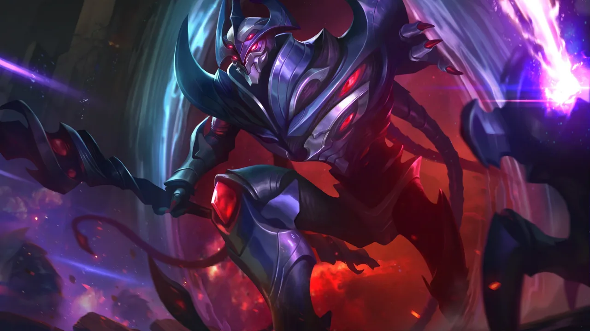
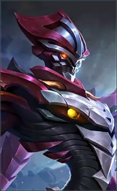

[Все скины](https://boostmlbb.ru/skins/)

[Скины](https://boostmlbb.ru/skins/)/Заск

# Скины Заска

Скинов

5

Можно купить

2

Последний

[Тень смерти](https://boostmlbb.ru/skins/zhask/death-s-shadow.html)2024

[Профиль героя→](https://boostmlbb.ru/heroes/zhask.html)

## Все скины

[Тень смертиИсключительный · 2024](https://boostmlbb.ru/skins/zhask/death-s-shadow.html)[ПришелецИсключительный · 2020](https://boostmlbb.ru/skins/zhask/extraterrestrial.html)[РакДелюкс · 2019](https://boostmlbb.ru/skins/zhask/cancer.html)[Костяной жрецИзысканный · 2018](https://boostmlbb.ru/skins/zhask/bone-flamen.html)[Крис­тальный хищникОбычный · 2017](https://boostmlbb.ru/skins/zhask/crystallized-predator.html)

**Сколько стоит буст на герое Заск?**Выберите текущий и желаемый ранг. Стоимость появится на сайте.

[Рассчитать цену](https://boostmlbb.ru/order.html?type=hero)

## Частые вопросы

Сколько скинов у Заска?

5 скинов без стандартного облика. Последний — «Тень смерти» (Death's Shadow), 1 октября 2024.

Какие скины Заска можно купить сейчас?

«Пришелец» (749 алмазов), «Кристальный хищник» (269 алмазов). Остальные облики ограниченные и возвращаются только в событиях.

Какой самый редкий скин Заска?

«Костяной жрец» (Bone Flamen), класс изысканный, серия «Ящик удачи». Выпадал из ящиков удачи в событиях. Ограниченные облики иногда возвращаются в розыгрышах событий.
