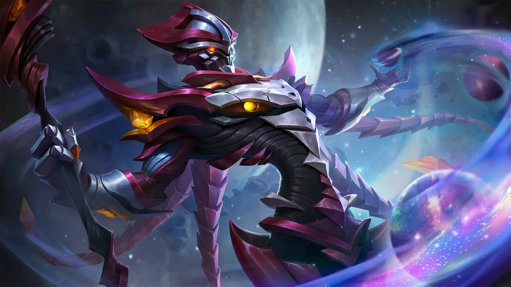
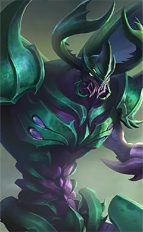

[Скины Заска](https://boostmlbb.ru/skins/zhask.html)

[Скины](https://boostmlbb.ru/skins/)/[Заск](https://boostmlbb.ru/skins/zhask.html)/Кристальный хищник

[Скин Заска](https://boostmlbb.ru/skins/zhask.html)

# Кристальный хищник

Crystallized Predator

Обычный CommonВ продаже

Как получить

Продаётся в магазине обликов за 269 алмазов.

Цена

269 алмазов

Вышел

29 ноября 2017

## Что меняет облик

-   Бонус к характеристикам

## Все скины Заска [5](https://boostmlbb.ru/skins/zhask.html)

[Тень смертиИсключительный · 2024](https://boostmlbb.ru/skins/zhask/death-s-shadow.html)[ПришелецИсключительный · 2020](https://boostmlbb.ru/skins/zhask/extraterrestrial.html)[РакДелюкс · 2019](https://boostmlbb.ru/skins/zhask/cancer.html)[Костяной жрецИзысканный · 2018](https://boostmlbb.ru/skins/zhask/bone-flamen.html)[Крис­тальный хищникОбычный · 2017](https://boostmlbb.ru/skins/zhask/crystallized-predator.html)

**Сколько стоит буст на герое Заск?**Выберите текущий и желаемый ранг. Стоимость появится на сайте.

[Рассчитать цену](https://boostmlbb.ru/order.html?type=hero)

## Частые вопросы

Как получить скин «Кристальный хищник» на Заска?

Продаётся в магазине обликов за 269 алмазов.

Когда вышел скин «Кристальный хищник»?

29 ноября 2017.

Какой класс у скина «Кристальный хищник»?

Обычный (Common).
