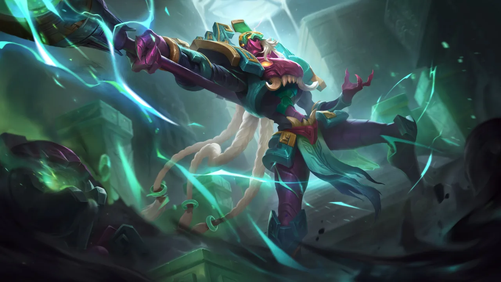

[Тир-лист](https://boostmlbb.ru/heroes/)[Предметы](https://boostmlbb.ru/items/)[Скины](https://boostmlbb.ru/skins/)[Новости и гайды](https://boostmlbb.ru/news/)

[Скины](https://boostmlbb.ru/skins/)/[Заск](https://boostmlbb.ru/skins/zhask.html)/Тень смерти

[Скин Заска](https://boostmlbb.ru/skins/zhask.html)

# Тень смерти

Death's Shadow

Исключительный ExceptionalЗвёздный участникОграниченный

Как получить

Награда «Звёздного участника» в октябре 2024.

Вышел

1 октября 2024

## Что меняет облик

-   Новая внешность
-   Новые эффекты навыков
-   Анимация показа
-   Сцена показа
-   Бонус к характеристикам

## Все скины Заска [5](https://boostmlbb.ru/skins/zhask.html)

[Тень смертиИсключительный · 2024](https://boostmlbb.ru/skins/zhask/death-s-shadow.html)[ПришелецИсключительный · 2020](https://boostmlbb.ru/skins/zhask/extraterrestrial.html)[РакДелюкс · 2019](https://boostmlbb.ru/skins/zhask/cancer.html)[Костяной жрецИзысканный · 2018](https://boostmlbb.ru/skins/zhask/bone-flamen.html)[Крис­тальный хищникОбычный · 2017](https://boostmlbb.ru/skins/zhask/crystallized-predator.html)

## Серия «Звёздный участник»

[Морячка, рождённая приливомКалеа · 2026](https://boostmlbb.ru/skins/kalea/tideborn-sailor.html)[Тень кицунэХаябуса · 2026](https://boostmlbb.ru/skins/hayabusa/kitsune-s-shadow.html)[Клыки резниХанзо · 2026](https://boostmlbb.ru/skins/hanzo/fangs-of-slaughter.html)[Тлеющая крепостьБелерик · 2026](https://boostmlbb.ru/skins/belerick/smouldering-fortress.html)[Магитех­нический призракОбсидия · 2026](https://boostmlbb.ru/skins/obsidia/magitech-wraith.html)[Элизийское сияниеЦзэтянь · 2026](https://boostmlbb.ru/skins/zetian/elysian-luminance.html)[Батальон стражейХильда · 2026](https://boostmlbb.ru/skins/hilda/guardian-battalion.html)[Мечта­тельный коиХарли · 2026](https://boostmlbb.ru/skins/harley/dreaming-koi.html)

**Поднимем ранг на герое Заск**Цена считается в калькуляторе

[Рассчитать цену](https://boostmlbb.ru/order.html?type=hero)

## Частые вопросы

Как получить скин «Тень смерти» на Заска?

Награда «Звёздного участника» в октябре 2024.

Когда вышел скин «Тень смерти»?

1 октября 2024.

Какой класс у скина «Тень смерти»?

Исключительный (Exceptional), серия «Звёздный участник».
