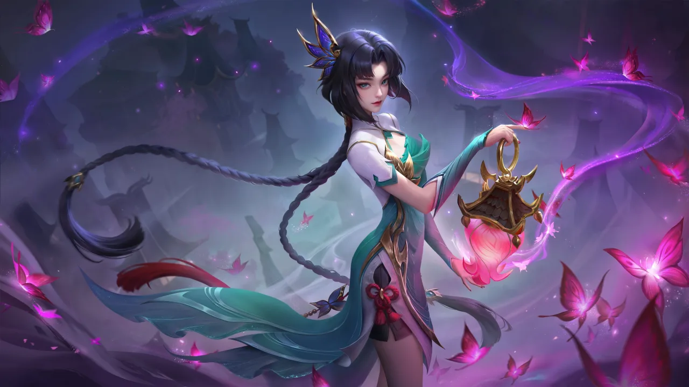

[Скины Чжусинь](https://boostmlbb.ru/skins/zhuxin.html)

[Скины](https://boostmlbb.ru/skins/)/[Чжусинь](https://boostmlbb.ru/skins/zhuxin.html)/Неземная безмятежность

[Скин Чжусинь](https://boostmlbb.ru/skins/zhuxin.html)

# Неземная безмятежность

Ethereal Serenity

Обычный CommonВ продаже

Как получить

Продаётся в магазине обликов за 269 алмазов.

Цена

269 алмазов

Вышел

29 июня 2024

## Что меняет облик

-   Бонус к характеристикам

## Все скины Чжусинь [3](https://boostmlbb.ru/skins/zhuxin.html)

[Чжусинь P.ACEДелюкс · 2025](https://boostmlbb.ru/skins/zhuxin/p-ace-zhuxin.html)[Мистик тлеющего огонькаИсключительный · 2025](https://boostmlbb.ru/skins/zhuxin/emberwisp-mystic.html)[Неземная безмя­тежностьОбычный · 2024](https://boostmlbb.ru/skins/zhuxin/ethereal-serenity.html)

**Сколько стоит буст на герое Чжусинь?**Выберите текущий и желаемый ранг. Стоимость появится на сайте.

[Рассчитать цену](https://boostmlbb.ru/order.html?type=hero)

## Частые вопросы

Как получить скин «Неземная безмятежность» на Чжусинь?

Продаётся в магазине обликов за 269 алмазов.

Когда вышел скин «Неземная безмятежность»?

29 июня 2024.

Какой класс у скина «Неземная безмятежность»?

Обычный (Common).
