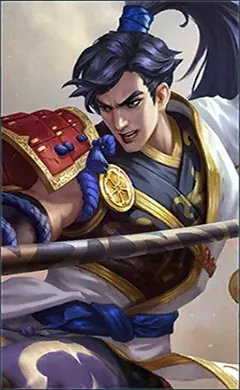

[Скины Зилонга](https://boostmlbb.ru/skins/zilong.html)

[Скины](https://boostmlbb.ru/skins/)/[Зилонг](https://boostmlbb.ru/skins/zilong.html)/Дракон процветания

[Скин Зилонга](https://boostmlbb.ru/skins/zilong.html)

# Дракон процветания

Dragon of Prosperity

Делюкс DeluxeЛунный фестивальОграниченный

Как получить

Выходил в магазине обликов во время события. Ограниченные облики иногда возвращаются в розыгрышах событий.

Вышел

9 февраля 2024

## Что меняет облик

-   Новая внешность
-   Новые эффекты навыков
-   Звуки навыков
-   Анимация показа
-   Сцена показа
-   Музыка показа
-   Бонус к характеристикам

## Все скины Зилонга [12](https://boostmlbb.ru/skins/zilong.html)

[Восходящий пламениДелюкс · 2026](https://boostmlbb.ru/skins/zilong/ascendant-of-flame.html)[Дракон процве­танияДелюкс · 2024](https://boostmlbb.ru/skins/zilong/dragon-of-prosperity.html)[Небесный паладинИзысканный · 2022](https://boostmlbb.ru/skins/zilong/empyrean-paladin.html)[Всадник буриИсключительный · 2022](https://boostmlbb.ru/skins/zilong/storm-rider.html)[Верное копьёОбычный · 2021](https://boostmlbb.ru/skins/zilong/loyal-spear.html)[Летние волныИсключительный · 2020](https://boostmlbb.ru/skins/zilong/summer-waves.html)[Рож­дественский карнавалИсключительный · 2018](https://boostmlbb.ru/skins/zilong/christmas-carnival.html)[Командир ЧанбаньпоИзысканный · 2018](https://boostmlbb.ru/skins/zilong/changbanpo-commander.html)[Пылающий копейщикОбычный · 2018](https://boostmlbb.ru/skins/zilong/blazing-lancer.html)[Элитный воинОбычный · 2017](https://boostmlbb.ru/skins/zilong/elite-warrior.html)[Восточный воинИсключительный · 2017](https://boostmlbb.ru/skins/zilong/eastern-warrior.html)[Славный генералДелюкс · 2017](https://boostmlbb.ru/skins/zilong/glorious-general.html)

## Серия «Лунный фестиваль»

[Благое пламяЛеоморд · 2026](https://boostmlbb.ru/skins/leomord/auspicious-blaze.html)[Цветение изобилияРафаэль · 2025](https://boostmlbb.ru/skins/rafaela/bloom-of-abundance.html)[НоволуниеЧан'Э · 2023](https://boostmlbb.ru/skins/change/new-moon.html)[Весенние благос­ловенияСан · 2022](https://boostmlbb.ru/skins/sun/spring-blessings.html)[Рассветная удачаЛо Йи · 2021](https://boostmlbb.ru/skins/luo-yi/dawning-fortune.html)[Благая удачаОдетта · 2019](https://boostmlbb.ru/skins/odette/auspicious-charm.html)[Танец льваЛолита · 2019](https://boostmlbb.ru/skins/lolita/lion-dance.html)[Лисья ледиАврора · 2018](https://boostmlbb.ru/skins/aurora/foxy-lady.html)

**Сколько стоит буст на герое Зилонг?**Выберите текущий и желаемый ранг. Стоимость появится на сайте.

[Рассчитать цену](https://boostmlbb.ru/order.html?type=hero)

## Частые вопросы

Как получить скин «Дракон процветания» на Зилонга?

Выходил в магазине обликов во время события. Ограниченные облики иногда возвращаются в розыгрышах событий.

Когда вышел скин «Дракон процветания»?

9 февраля 2024.

Какой класс у скина «Дракон процветания»?

Делюкс (Deluxe), серия «Лунный фестиваль».
