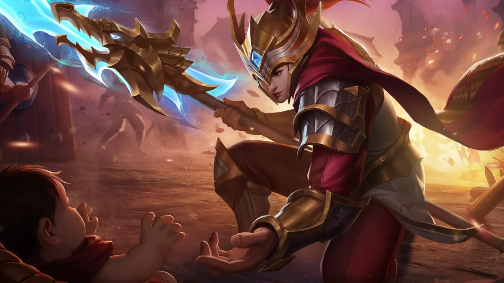

[Скины Зилонга](https://boostmlbb.ru/skins/zilong.html)

[Скины](https://boostmlbb.ru/skins/)/[Зилонг](https://boostmlbb.ru/skins/zilong.html)/Элитный воин

[Скин Зилонга](https://boostmlbb.ru/skins/zilong.html)

# Элитный воин

Elite Warrior

Обычный CommonЭлитныйВ продаже

Как получить

Продаётся в магазине обликов за 399 алмазов.

Цена

399 алмазов

Вышел

11 августа 2017

## Что меняет облик

-   Бонус к характеристикам

## Перекраски

Тот же облик в других цветах. Перекраска открывается, только если у вас уже есть сам облик.

-   **Серебряный воин** Argenta Warrior
-   **Воин-дракон** Dragon WarriorНаграда «Звёздного участника» в мае 2019.

## Все скины Зилонга [12](https://boostmlbb.ru/skins/zilong.html)

[Восходящий пламениДелюкс · 2026](https://boostmlbb.ru/skins/zilong/ascendant-of-flame.html)[Дракон процве­танияДелюкс · 2024](https://boostmlbb.ru/skins/zilong/dragon-of-prosperity.html)[Небесный паладинИзысканный · 2022](https://boostmlbb.ru/skins/zilong/empyrean-paladin.html)[Всадник буриИсключительный · 2022](https://boostmlbb.ru/skins/zilong/storm-rider.html)[Верное копьёОбычный · 2021](https://boostmlbb.ru/skins/zilong/loyal-spear.html)[Летние волныИсключительный · 2020](https://boostmlbb.ru/skins/zilong/summer-waves.html)[Рож­дественский карнавалИсключительный · 2018](https://boostmlbb.ru/skins/zilong/christmas-carnival.html)[Командир ЧанбаньпоИзысканный · 2018](https://boostmlbb.ru/skins/zilong/changbanpo-commander.html)[Пылающий копейщикОбычный · 2018](https://boostmlbb.ru/skins/zilong/blazing-lancer.html)[Элитный воинОбычный · 2017](https://boostmlbb.ru/skins/zilong/elite-warrior.html)[Восточный воинИсключительный · 2017](https://boostmlbb.ru/skins/zilong/eastern-warrior.html)[Славный генералДелюкс · 2017](https://boostmlbb.ru/skins/zilong/glorious-general.html)

## Серия «Элитный»

[Золотой османтусЧан'Э · 2026](https://boostmlbb.ru/skins/change/golden-osmanthus.html)[Король-воена­чальникМартис · 2025](https://boostmlbb.ru/skins/martis/warlord-king.html)[Кадет открытого моряКимми · 2024](https://boostmlbb.ru/skins/kimmy/high-seas-cadet.html)[Зелёная копейщицаСильвана · 2024](https://boostmlbb.ru/skins/silvanna/verdant-lancer.html)[Мародёр Кровавое КопытоХилос · 2024](https://boostmlbb.ru/skins/hylos/bloodhoof-marauder.html)[Изящная бабочкаГвиневра · 2024](https://boostmlbb.ru/skins/guinevere/elegant-butterfly.html)[Маркиз клинковЛанселот · 2024](https://boostmlbb.ru/skins/lancelot/marques-of-blades.html)[Привал в пустошахЧип · 2024](https://boostmlbb.ru/skins/chip/badlands-hiatus.html)

**Сколько стоит буст на герое Зилонг?**Выберите текущий и желаемый ранг. Стоимость появится на сайте.

[Рассчитать цену](https://boostmlbb.ru/order.html?type=hero)

## Частые вопросы

Как получить скин «Элитный воин» на Зилонга?

Продаётся в магазине обликов за 399 алмазов.

Когда вышел скин «Элитный воин»?

11 августа 2017.

Какой класс у скина «Элитный воин»?

Обычный (Common), серия «Элитный».
