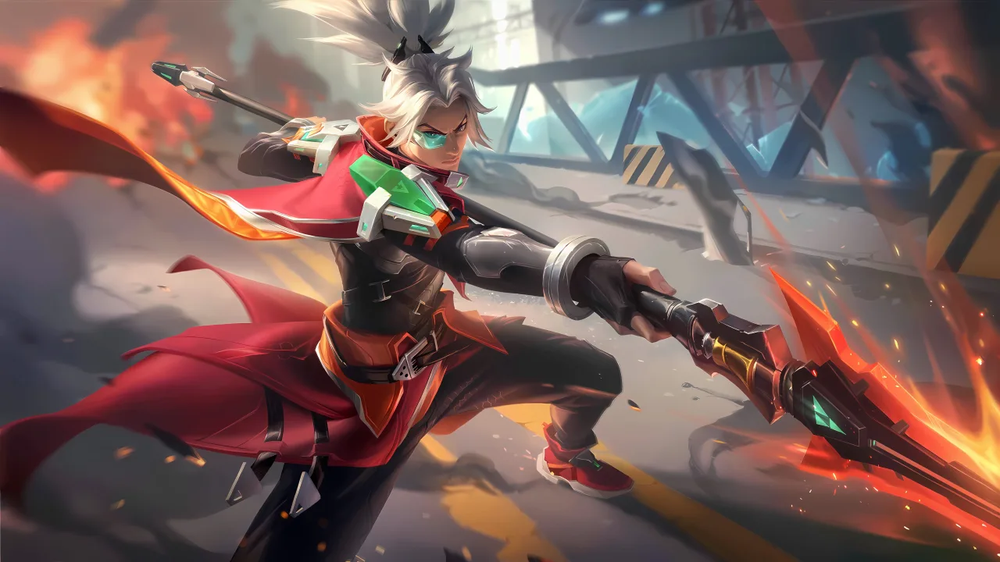

[Тир-лист](https://boostmlbb.ru/heroes/)[Предметы](https://boostmlbb.ru/items/)[Скины](https://boostmlbb.ru/skins/)[Новости и гайды](https://boostmlbb.ru/news/)

[Скины](https://boostmlbb.ru/skins/)/[Зилонг](https://boostmlbb.ru/skins/zilong.html)/Всадник бури

[Скин Зилонга](https://boostmlbb.ru/skins/zilong.html)

# Всадник бури

Storm Rider

Исключительный ExceptionalФестиваль 5.15Ограниченный

Как получить

Выходил в событии «Фестиваль 5.15». Ограниченные облики иногда возвращаются в розыгрышах событий.

Вышел

2022 год

## Что меняет облик

-   Новая внешность
-   Новые эффекты навыков
-   Анимация показа
-   Бонус к характеристикам

## Все скины Зилонга [12](https://boostmlbb.ru/skins/zilong.html)

[Восходящий пламениДелюкс · 2026](https://boostmlbb.ru/skins/zilong/ascendant-of-flame.html)[Дракон процве­танияДелюкс · 2024](https://boostmlbb.ru/skins/zilong/dragon-of-prosperity.html)[Небесный паладинИзысканный · 2022](https://boostmlbb.ru/skins/zilong/empyrean-paladin.html)[Всадник буриИсключительный · 2022](https://boostmlbb.ru/skins/zilong/storm-rider.html)[Верное копьёОбычный · 2021](https://boostmlbb.ru/skins/zilong/loyal-spear.html)[Летние волныИсключительный · 2020](https://boostmlbb.ru/skins/zilong/summer-waves.html)[Рож­дественский карнавалИсключительный · 2018](https://boostmlbb.ru/skins/zilong/christmas-carnival.html)[Командир ЧанбаньпоИзысканный · 2018](https://boostmlbb.ru/skins/zilong/changbanpo-commander.html)[Пылающий копейщикОбычный · 2018](https://boostmlbb.ru/skins/zilong/blazing-lancer.html)[Элитный воинОбычный · 2017](https://boostmlbb.ru/skins/zilong/elite-warrior.html)[Восточный воинИсключительный · 2017](https://boostmlbb.ru/skins/zilong/eastern-warrior.html)[Славный генералДелюкс · 2017](https://boostmlbb.ru/skins/zilong/glorious-general.html)

## Серия «Фестиваль 5.15»

[Знаток модыХарит · 2021](https://boostmlbb.ru/skins/harith/fashion-expert.html)

**Поднимем ранг на герое Зилонг**Цена считается в калькуляторе

[Рассчитать цену](https://boostmlbb.ru/order.html?type=hero)

## Частые вопросы

Как получить скин «Всадник бури» на Зилонга?

Выходил в событии «Фестиваль 5.15». Ограниченные облики иногда возвращаются в розыгрышах событий.

Когда вышел скин «Всадник бури»?

2022 год.

Какой класс у скина «Всадник бури»?

Исключительный (Exceptional), серия «Фестиваль 5.15».
